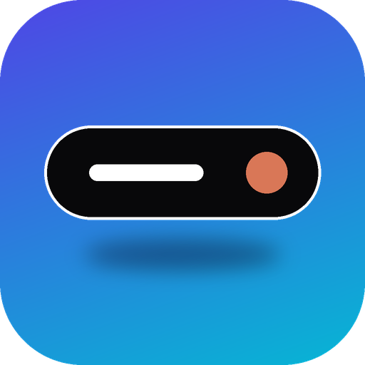

<p align="center">
  
</p>

<h1 align="center">FloatIsland</h1>

<p align="center">
  A tiny, Dynamic Island–inspired status pill for Windows and Linux.<br>
  System stats, media controls, notifications, Claude usage and monitor brightness, in one native window.
</p>

<p align="center">
  <a href="https://github.com/KresnaB/Float-Island/releases/latest"></a>
  
  
  <a href="LICENSE"></a>
</p>

---

FloatIsland is a black pill that floats over your desktop. Collapsed, it shows CPU, RAM and GPU load. Hover over it to open a panel with the media that's playing, recent notifications, your Claude quota and a brightness slider for each monitor. When a notification arrives, the pill briefly grows to show it.

It is written in Rust. On Windows it talks to the raw Win32 and WinRT APIs: no Electron, no WebView, no .NET runtime and no GPU driver load. The whole app is a single ~420 KB exe that uses about **15–19 MB of RAM** and **~0.1% CPU**. On Linux the same island is drawn with GTK4 and runs on **KDE Plasma, Hyprland and GNOME** (see [Linux](#linux)).

> The UI text is in Indonesian (Bahasa Indonesia).

## Contents

- [Features](#features)
- [Resource usage](#resource-usage)
- [Install](#install)
- [Linux](#linux)
- [Using FloatIsland](#using-floatisland)
- [How it works](#how-it-works)
- [Privacy](#privacy)
- [Files and settings](#files-and-settings)
- [Building from source](#building-from-source)
- [Project structure](#project-structure)
- [Known limitations](#known-limitations)
- [Contributing](#contributing)
- [License](#license)

## Features

**Collapsed pill**
- Live **CPU / RAM / GPU** percentages, updated every second. The pill keeps a fixed width, so changing numbers never make it jump.
- A status icon on the right: an orange gear while a Claude Code session is working, a green note while media plays. Text and icon slide and fade smoothly when the icon comes or goes.

**Expanded panel** (hover over the pill)
- **Media**: title and artist of whatever is playing in any app that reports to Windows media controls (Chrome, Edge, Brave, Firefox, Spotify, …), with previous / play-pause / next buttons. Buttons the app doesn't support (for example "next" on YouTube Shorts) are dimmed.
- **Notifications**: a carousel of the last 10 Windows notifications. Browse with ‹ › or the mouse wheel; × dismisses a notification here *and* in the Windows notification center.
- **System meters**: CPU, RAM and GPU bars.
- **Pager** with two pages, switched with ‹ › in its header:
  1. **Claude quota**: your plan's limits (for example the 5-hour session and weekly per-model limits) with percent used and time until reset, the same numbers the Claude app shows.
  2. **Screen brightness**: one slider per external monitor (DDC/CI). Click, drag, or scroll over a slider.
- **Claude Code sessions**: up to 3 running sessions with their state ("bekerja" = working, "idle").

**Notifications as a pop-up**
- New Windows notifications, and a "Claude selesai" (Claude finished) message when a Claude Code session goes from working to idle, expand the pill for 5 seconds.

**Behaviour**
- **Two positions**, picked from the tray menu and remembered: *top center* of the screen, or *bottom right* just above the taskbar (the panel then grows up and to the left).
- **Gets out of the way**: hides instantly when a game, a fullscreen video or a fullscreen browser is in front, and, in the top position, when a browser is maximized on the main monitor (its tabs would sit under the island). It reacts to window events, so it disappears within ~15–30 ms.
- **System tray icon** with the position options and *Keluar* (Exit).
- **Starts with Windows**, **one instance only**, per-user install with an entry in *Settings → Apps → Installed apps*.

## Resource usage

Measured on Windows 11 (12-thread CPU, 2 monitors), averaged over 30 seconds:

| | FloatIsland |
|---|---|
| Executable | ~420 KB, single file |
| RAM (private) | 15–19 MB |
| CPU | ~0.1% |
| GPU | none (software rasterizer, no D3D driver loaded) |

Background work: one poll per second (stats, media, notifications, Claude sessions), monitor brightness every 10 s, Claude quota every 5 min. The window only repaints on those ticks and during short animations.

For comparison, apps built on Electron or a WebView typically sit at 80–150 MB.

## Install

1. Download **`FloatIsland-Setup-<version>.exe`** from the [latest release](https://github.com/KresnaB/Float-Island/releases/latest).
2. Run it. It installs for your user only (no admin rights) and starts the island.
3. The exe isn't code-signed, so Windows SmartScreen may say *"Windows protected your PC"*. Click **More info → Run anyway**.

The setup is the app itself: when the exe's file name starts with `FloatIsland-Setup`, it installs itself instead of running. Installing a newer version over an older one replaces it in place.

**Uninstall:** *Settings → Apps → Installed apps → FloatIsland → Uninstall*. This stops the island and removes the program files, the Start Menu shortcut, autostart and the Installed apps entry.

## Linux

FloatIsland 0.2.0 adds a Linux build with the same island, panel and tray menu.

**Supported desktops**

| Desktop | How the island is placed | Tray menu |
|---|---|---|
| KDE Plasma (Wayland) | wlr-layer-shell (XWayland if `gtk4-layer-shell` isn't installed) | built in |
| Hyprland, Sway and other wlroots compositors | wlr-layer-shell | needs a bar with a tray, e.g. waybar |
| GNOME (Wayland or X11) | through XWayland as an always-on-top dock window, because GNOME has no layer-shell | needs the *AppIndicator and KStatusNotifierItem Support* extension (preinstalled on Ubuntu) |

Without a tray, right-click the island to quit.

**Install**

1. Install the runtime libraries. `gtk4-layer-shell` is optional but gives native placement on KDE/Hyprland/Sway (without it the island runs through XWayland); `ddcutil` is optional, for external monitor brightness:

   | Distro | Command |
   |---|---|
   | Ubuntu 24.04 | `sudo apt install libgtk-4-1 libdbus-1-3 ddcutil` |
   | Ubuntu 25.04+ / Debian 13 | `sudo apt install libgtk-4-1 libgtk4-layer-shell0 libdbus-1-3 ddcutil` |
   | Fedora | `sudo dnf install gtk4 gtk4-layer-shell dbus-libs ddcutil` |
   | Arch | `sudo pacman -S gtk4 gtk4-layer-shell dbus ddcutil` |

2. Download **`FloatIsland-<version>-linux-x86_64.tar.gz`** from the [latest release](https://github.com/KresnaB/Float-Island/releases/latest), extract it and run the installer:

   ```bash
   tar xzf FloatIsland-0.2.0-linux-x86_64.tar.gz
   ```

   ```bash
   ./FloatIsland-0.2.0-linux-x86_64/install.sh
   ```

   It installs for your user only (`~/.local/bin/floatisland`), adds an app launcher entry and an autostart entry, and starts the island. Pass `--no-autostart` to skip the autostart entry.

3. **Hyprland** doesn't run XDG autostart entries: add `exec-once = ~/.local/bin/floatisland` to `~/.config/hypr/hyprland.conf`.

**Uninstall:** run `~/.local/share/floatisland/uninstall.sh` (add `--purge` to also delete the saved position).

**Brightness** works for external monitors through `ddcutil` (DDC/CI; your user may need to be in the `i2c` group: `sudo usermod -aG i2c $USER`, then log in again) and for laptop screens through systemd-logind, which needs no root.

**Settings:** the position is saved in `~/.config/floatisland/position`.

## Using FloatIsland

| Action | How |
|---|---|
| Open the panel | Hover over the pill |
| Media controls | Panel → ⏮ ⏯ ⏭ |
| Browse notifications | Panel → ‹ › or mouse wheel over the notification row |
| Dismiss a notification | Panel → × |
| Claude quota / brightness | Panel → ‹ › in the pager header |
| Change brightness | Brightness page → click or drag a slider, or scroll over it (±5%) |
| Change position | Tray icon → *Posisi: Atas* (top) or *Posisi: Kanan bawah* (bottom right) |
| Exit | Tray icon → *Keluar*, or right-click the pill |

Windows 11 puts new tray icons in the overflow menu (**^**). Drag the FloatIsland icon onto the taskbar, or enable it in *Settings → Personalization → Taskbar → Other system tray icons*, to keep it visible.

Autostart can be turned off in *Task Manager → Startup apps*. FloatIsland respects that switch.

## How it works

Everything runs in one process: a UI thread that owns the window and a worker thread that polls the data sources and posts a message when there's something new.

| Feature | Source |
|---|---|
| Window | One layered `WS_EX_LAYERED` top-most tool window. Direct2D (software render target) draws into a 32-bit DIB that `UpdateLayeredWindow` blits with per-pixel alpha, so transparent pixels are click-through. DirectWrite for text, *Segoe Fluent Icons* for glyphs. |
| CPU | `GetSystemTimes` deltas |
| RAM | `GlobalMemoryStatusEx` |
| GPU | PDH counter `\GPU Engine(*engtype_3D)\Utilization Percentage`, summed |
| Media | WinRT `GlobalSystemMediaTransportControlsSessionManager` (SMTC) |
| Notifications | WinRT `UserNotificationListener`, polled; dismiss uses `RemoveNotification` |
| Claude Code sessions | The JSON files Claude Code keeps in `%USERPROFILE%\.claude\sessions\` (name, status, PID; dead PIDs are ignored) |
| Claude quota | `GET https://api.anthropic.com/api/oauth/usage` with the Claude Code login token from `%USERPROFILE%\.claude\.credentials.json`. It shows the `limits` list as-is, so it matches the Claude app for any plan. When the token has expired it runs `claude auth status` (hidden), which makes Claude Code refresh it. |
| Brightness | DDC/CI through `dxva2` (`GetMonitorBrightness` / `SetMonitorBrightness`). The value lives in the monitor itself, so it survives reboots. |
| Hiding | `SHQueryUserNotificationState` (fullscreen / presentation / D3D fullscreen) plus a check for a maximized browser on the main monitor, triggered by `SetWinEventHook` foreground and location events |
| Tray, autostart, install | `Shell_NotifyIconW`, `HKCU\...\Run`, `IShellLinkW` for the Start Menu shortcut, `HKCU\...\Uninstall` |

On **Linux** the same structure uses:

| Feature | Source |
|---|---|
| Window | GTK4 window drawn with cairo + pango. wlr-layer-shell on KDE and wlroots compositors (`gtk4-layer-shell`, loaded at runtime through `LD_PRELOAD` because it must load before libwayland-client, so it stays optional); on GNOME an X11 dock window (`_NET_WM_WINDOW_TYPE_DOCK`, above, sticky) through XWayland. The input region is the pill, so the rest is click-through. |
| CPU / RAM | `/proc/stat`, `/proc/meminfo` |
| GPU | `/sys/class/drm/*/device/gpu_busy_percent` (AMD, Intel Xe) or NVML (NVIDIA, loaded at runtime) |
| Media | MPRIS over D-Bus |
| Notifications | A D-Bus monitor on `org.freedesktop.Notifications.Notify` (works with any notification daemon); dismiss calls `CloseNotification` |
| Brightness | `ddcutil` (external monitors), systemd-logind `SetBrightness` (laptop backlight) |
| Claude | The same `~/.claude` session files, credentials and quota endpoint as on Windows |
| Tray | StatusNotifierItem via [`ksni`](https://crates.io/crates/ksni) |
| Hiding | Left to the compositor: fullscreen windows cover the island's layer |

On Windows only one dependency is used at runtime: the [`windows`](https://crates.io/crates/windows) crate. [`winresource`](https://crates.io/crates/winresource) is a build-time dependency that embeds the icon and version info.

## Privacy

- FloatIsland reads **locally**: system counters, the Windows media session, your Windows notifications (it asks for notification access the first time), and the Claude Code session files and login token in your user profile.
- The **only network request** is the Claude quota call to `api.anthropic.com`, made every 5 minutes with **your own** Claude Code token. Nothing else leaves your PC, and there is no telemetry.
- Notification text is only kept in memory (last 10) and is gone when the app exits.
- If you don't use Claude Code, the quota page just shows a "not logged in" message and no request is made.

## Files and settings

| What | Where |
|---|---|
| Program | `%LOCALAPPDATA%\Programs\FloatIsland\FloatIsland.exe` |
| Start Menu shortcut | `%APPDATA%\Microsoft\Windows\Start Menu\Programs\FloatIsland.lnk` |
| Autostart | `HKCU\Software\Microsoft\Windows\CurrentVersion\Run` → `FloatIsland` |
| Installed apps entry | `HKCU\Software\Microsoft\Windows\CurrentVersion\Uninstall\FloatIsland` |
| Position setting | `HKCU\Software\FloatIsland` → `Position` (0 = top, 1 = bottom right). Kept after uninstall. |

## Building from source

Requirements:

- Windows 10/11 x64
- [Rust](https://rustup.rs/) with the MSVC toolchain (`stable-x86_64-pc-windows-msvc`)
- Visual Studio Build Tools with the Windows SDK (provides `rc.exe`, used to embed the icon)

Build:

```bash
git clone https://github.com/KresnaB/Float-Island.git
cd Float-Island
cargo build --release
```

The app is `target/release/FloatIsland.exe`. Running it from there works like normal, except it doesn't register autostart (only the installed copy does, so dev builds don't take over your startup entry). Only one island runs at a time, so quit the installed one first (tray → *Keluar*).

Run the tests:

```bash
cargo test --release
```

Make an installer: copy the built exe with a `FloatIsland-Setup-` prefix.

```bash
cp target/release/FloatIsland.exe dist/FloatIsland-Setup-0.2.0.exe
```

**On Linux**, install the development packages first (Ubuntu: `sudo apt install libgtk-4-dev libdbus-1-dev pkg-config`), then:

```bash
cargo build --release
```

```bash
./packaging/linux/install.sh
```

Run from the repository, the installer picks up `target/release/FloatIsland`. CI ([`.github/workflows/ci.yml`](.github/workflows/ci.yml)) builds and tests both platforms and packages the Linux tarball.

Change the logo: edit [`assets/make_icon.py`](assets/make_icon.py) (needs Python with Pillow) and regenerate `assets/icon.ico` and `assets/logo.png`:

```bash
python assets/make_icon.py
```

## Project structure

```
src/main.rs          Entry point: picks the Windows or Linux front end
src/common.rs        Shared state, commands and helpers (with tests)
src/win/mod.rs       Windows: window, drawing, layout and animation, input, tray, positions, hiding rules
src/win/data.rs      Windows worker: CPU/RAM/GPU, media, notifications, Claude, DDC/CI brightness
src/win/install.rs   Windows self-installer, uninstaller, autostart, settings in the registry
src/linux/mod.rs     Linux: GTK4 window, cairo/pango drawing, layer-shell / XWayland placement, tray
src/linux/data.rs    Linux worker: /proc, sysfs/NVML, MPRIS, notification monitor, ddcutil/logind, Claude
packaging/linux/     install.sh, uninstall.sh and the .desktop entry
build.rs             Embeds the icon and version info into the Windows exe
assets/              Logo (PNG), icon (ICO), tray pixmap and the script that draws them
```

## Known limitations

- **Windows**: Windows 11 only in practice: the icons use *Segoe Fluent Icons*, which Windows 10 doesn't ship. Tested on Windows 11 at 100% scaling.
- **Linux**: built and unit-tested in CI, but not yet tried on every desktop. Please [open an issue](https://github.com/KresnaB/Float-Island/issues) with your desktop and distro if something looks off. The binary is built on Ubuntu 24.04 and needs glibc 2.39 or newer. Hiding for fullscreen apps is left to the compositor, and the "hide for a maximized browser" rule is Windows-only. On GNOME the island goes through XWayland, so it can look slightly soft with fractional scaling.
- **Primary monitor only**: the island lives on the main monitor; DPI is read once at startup.
- **Brightness** works for external monitors with DDC/CI enabled. Laptop built-in panels (which need WMI) are not supported yet. Monitors are labelled by position (*Utama* = main, *Kiri* = left, …) because Windows reports them as "Generic PnP Monitor".
- **Claude quota** uses an undocumented endpoint and Claude Code's login, so it may break if those change. It shows the account Claude Code (CLI) is logged into, which can differ from the Claude desktop app's account. Run `claude auth login` with the same account to match them.
- The **GPU** figure is 3D engine load, like Task Manager's default view. Compute/copy engines are not included.
- The exe is **not code-signed**, so SmartScreen warns on first run.

## Contributing

Issues and pull requests are welcome. Keep the spirit of the project: small, native, and light on resources. Prefer the Windows APIs that are already used over new dependencies, and check memory/CPU usage before and after your change.

## License

[MIT](LICENSE) © 2026 Kresna Bayu Sanyoto

FloatIsland is an independent project. It is inspired by Apple's Dynamic Island and is not affiliated with or endorsed by Apple or Anthropic. "Claude" is a trademark of Anthropic.
